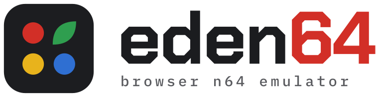
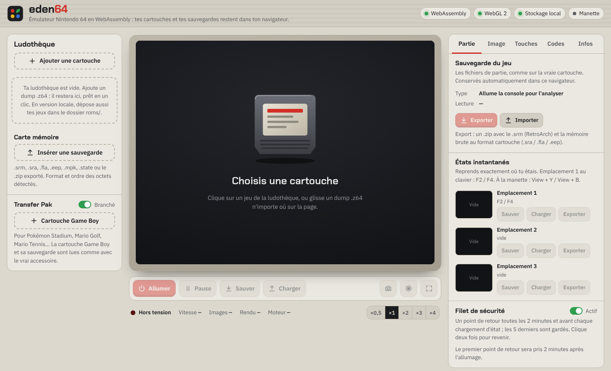

<p align="center">
  <picture>
    <source media="(prefers-color-scheme: dark)" srcset="docs/logo-dark.svg">
    
  </picture>
</p>

<p align="center">
  Émulateur Nintendo 64 qui tourne dans le navigateur (WebAssembly). Rien à installer, pas de compte : tes jeux et tes sauvegardes restent sur ton appareil.<br>
  <a href="https://eden64.netlify.app"><b>Essayer</b></a> · <a href="https://edenbourezg.myportfolio.com/eden64">Présentation du projet</a> · <a href="LISEZMOI.txt">Manuel</a>
</p>

<p align="center">
  <a href="../../actions/workflows/ci.yml"></a>
  
</p>



## Fonctionnalités

- **Deux moteurs, choisis selon l'appareil :** mupen64plus-next + GLideN64 (jusqu'à 2560×1920, 16:9 natif, textures améliorées) ou ParaLLEl-N64 pour les téléphones et les petites machines (~300 Mo au lieu de ~900 Mo).
- **Sauvegardes :** gardées dans le navigateur ; import/export `.srm .sra .fla .eep .mpk` (ordre des octets détecté) ; 3 emplacements d'état ; filet de sécurité toutes les 2 min et avant chaque chargement.
- **Accessoires :** Controller Pak, Rumble Pak (vibration de la vraie manette), Transfer Pak avec cartouche et sauvegarde Game Boy (Pokémon Stadium…), choisis automatiquement selon le jeu.
- **Commandes :** touches clavier et manette réassignables (combinaisons comprises), manettes détectées automatiquement, manette tactile sur mobile.
- **En plus :** codes GameShark pour 742 jeux, captures PNG, clips MP4 avec le son, partitions d'ocarina, plein écran.
- **Régulateur de performance :** détecte la machine, trouve la cause des ralentissements et propose un réglage plus léger en un clic.

## Lancer

- **En ligne :** [eden64.netlify.app](https://eden64.netlify.app), puis *Ajouter une cartouche*.
- **Windows :** double-clique sur `Lancer.bat`, puis ouvre http://localhost:8064.
- **Tout système (Node 18+) :** `node serveur.mjs`.

Dépose tes dumps dans `roms/` pour les voir dans la ludothèque. Aucun jeu n'est fourni : utilise les dumps de tes propres cartouches. `roms/` est ignoré par Git et la CI échoue si un dump est ajouté au dépôt.

## Déployer

Site statique, sans étape de build. Sur Netlify, importe ce dépôt : `netlify.toml` publie la racine et `_headers` pose COOP/COEP et la CSP.

## Fonctionnement

- [EmulatorJS 4.2.3](https://github.com/EmulatorJS/EmulatorJS) avec un petit patch ([emulator/emulatorjs-4.2.3.patch](emulator/emulatorjs-4.2.3.patch)) qui ajoute des points d'accroche : chargement du core brut, rappels à chaque image, configuration RetroArch supplémentaire.
- Les cores sont livrés décompressés (versions WebGL 2 et WebGL 1). Leur mémoire WebAssembly initiale est réduite au chargement pour que les téléphones puissent l'allouer.
- Vibration : le rappel de vibration du core est redirigé vers un mini module WebAssembly écrit à la main, qui appelle l'API de vibration des manettes.
- Tout le reste est du JavaScript simple dans `app.js`. Pas de framework, pas de bundler.

## Développement

```sh
node tests/smoke.mjs                                     # lance le site et vérifie chaque fichier (aucune dépendance)
python tools/build_cheats.py <libretro-database> cheats  # régénère les codes de triche
```

## Licence

eden64 est sous GPL-3.0, comme EmulatorJS. Composants tiers : [THIRD_PARTY.md](THIRD_PARTY.md).
Projet non affilié à Nintendo. Nintendo 64 est une marque de Nintendo.

Design et développement : [Eden Bourezg](https://edenbourezg.myportfolio.com).
