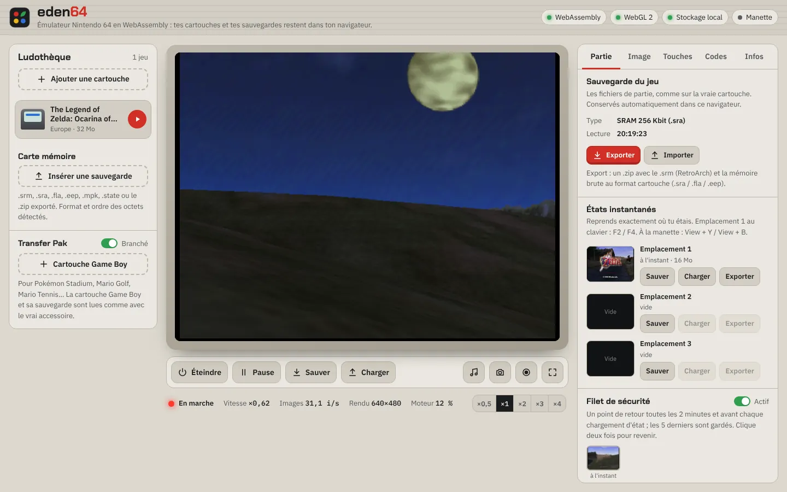
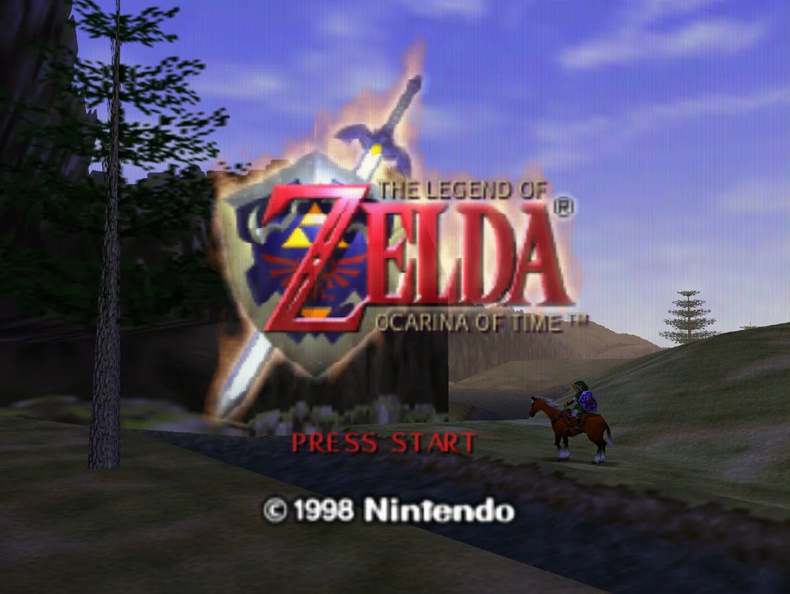
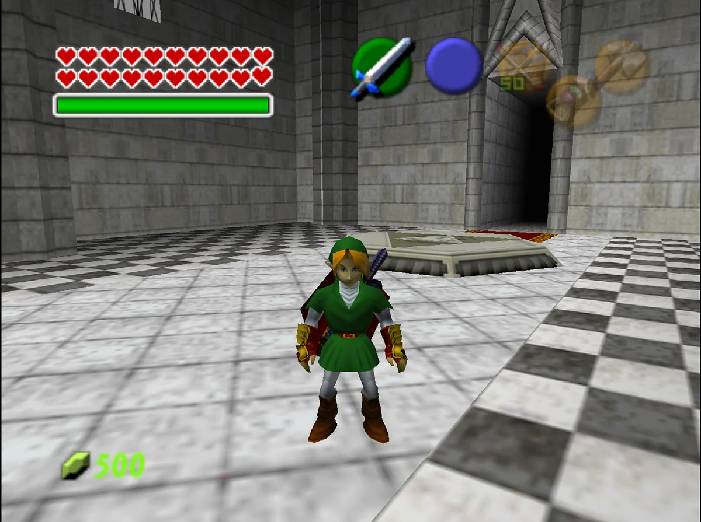

<p align="center">
  <picture>
    <source media="(prefers-color-scheme: dark)" srcset="docs/logo-dark.svg">
    
  </picture>
</p>

<p align="center">
  Un émulateur Nintendo 64 qui tourne dans le navigateur, sur ordinateur comme sur téléphone. Rien à installer, aucun compte : tes cartouches et tes sauvegardes restent sur ton appareil.<br>
  <a href="https://swagedencool.github.io/eden64/"><b>Jouer</b></a> · <a href="docs/MANUEL.md">Manuel</a> · <a href="docs/TECHNIQUE.md">Notes techniques</a>
</p>

<p align="center">
  <a href="../../actions/workflows/ci.yml"></a>
  
  
</p>



> Testé de bout en bout avec **The Legend of Zelda: Ocarina of Time** (version européenne). Les autres jeux passent par les mêmes moteurs, mais n'ont pas tous été essayés.

## Fonctionnalités

### Tes parties ne se perdent pas

La sauvegarde du jeu est gardée dans le navigateur, comme sur la vraie cartouche. Elle s'importe et s'exporte (`.srm`, `.sra`, `.fla`, `.eep`, `.mpk`), et l'ordre des octets est détecté tout seul. Trois emplacements d'état permettent de reprendre exactement où tu étais, et le **filet de sécurité** prend un point de retour toutes les 2 minutes et avant chaque chargement.

### Une belle image, même sur une petite machine

Deux moteurs : **mupen64plus-next + GLideN64** (jusqu'à 2560×1920, 16:9 natif, textures améliorées) et **ParaLLEl-N64** pour les téléphones et les petites configurations (~300 Mo de mémoire au lieu de ~900 Mo). eden64 choisit selon l'appareil. S'il ralentit, il cherche la cause (économiseur d'énergie, rendu sans carte graphique, processeur saturé) et propose un réglage plus léger en un clic.

<table>
  <tr>
    <td width="50%"></td>
    <td width="50%"></td>
  </tr>
</table>

### À ta main : manette, clavier, tactile

Toutes les touches se changent, au clavier (AZERTY ou QWERTY) comme à la manette, combinaisons comprises. Les manettes sont détectées toutes seules, la **vibration** passe par la vraie manette, et une manette tactile s'affiche sur téléphone. L'accessoire est choisi selon le jeu : carte mémoire, Rumble Pak ou **Transfer Pak** avec ta cartouche Game Boy (Pokémon Stadium, Mario Golf…).

### À deux, à distance

Crée une salle dans l'onglet **À deux** et envoie le lien à un ami, comme dans [PokéLink](https://github.com/swagedencool/eden-pokelink).

- **Chacun sa partie** (Ocarina of Time) : vous jouez chacun avec votre cartouche, et ton ami apparaît dans ton monde, à sa vraie place, avec son pseudo. Il est visible quand vous êtes dans la même zone ; sinon une flèche ou un message indique où il est. Ses déplacements sont lus dans la mémoire du jeu et dessinés avec la caméra du jeu.
- **Partager mon écran** (tous les jeux) : ton ami voit ton jeu en direct, avec le son, sans cartouche. Il regarde, joue avec ta manette ou prend la manette 2, et peut demander la manette.

Dans les deux cas : réactions, pseudo, et les navigateurs se parlent directement, chiffré de bout en bout.

### Codes, ocarina, captures

GameShark : codes pour 742 jeux, reconnus par l'empreinte de la cartouche. Partitions d'ocarina : les 12 mélodies avec tes touches, et la mélodie jouée est reconnue. Captures PNG et clips vidéo MP4 avec le son, en un clic ou un raccourci, et un mode plein écran.

## Jouer

1. Va sur **[swagedencool.github.io/eden64](https://swagedencool.github.io/eden64/)**.
2. *Ajouter une cartouche* : choisis ton dump (`.z64`, `.n64`, `.v64` ou `.zip`). Il reste dans ta ludothèque.
3. *Allumer*, ou A / Start à la manette.

En local : `node tools/serveur.mjs` (ou `tools\Lancer.bat` sous Windows, sans rien installer), puis http://localhost:8064. Les dumps déposés dans `roms/` apparaissent dans la ludothèque.

Aucun jeu n'est fourni : utilise les dumps de tes propres cartouches.

## Fonctionnement

- **Site statique**, sans serveur ni compte : tout tourne dans le navigateur, en WebAssembly.
- **Émulateur** : [EmulatorJS](https://github.com/EmulatorJS/EmulatorJS) et les cœurs libretro mupen64plus-next et ParaLLEl-N64, avec un petit patch qui ouvre des points d'accroche.
- **À deux** : WebRTC pair-à-pair avec [Trystero](https://github.com/dmotz/trystero) (`web/duo.js`).
- Le reste est du JavaScript simple dans `web/app.js`, sans framework ni bundler. Détails : [docs/TECHNIQUE.md](docs/TECHNIQUE.md).

## Développement

```sh
node tools/serveur.mjs                     # le site en local : http://localhost:8064
node tests/smoke.mjs                       # vérifie que chaque fichier du site est servi (aucune dépendance)
python tests/duo_e2e.py                    # « À deux » dans deux onglets (Playwright, un jeu dans roms/)
python tools/build_cheats.py <libretro-database>   # régénère les codes dans web/cheats/
```

Chaque envoi sur `main` lance la [CI](.github/workflows/ci.yml) : syntaxe, test de fumée, et refus de tout dump ou sauvegarde dans le dépôt. Si elle passe, le dossier `web/` est publié tel quel sur GitHub Pages.

## Licence

eden64 est sous GPL-3.0, comme EmulatorJS. Composants tiers : [THIRD_PARTY.md](THIRD_PARTY.md).
Projet de fan, sans lien avec Nintendo. Nintendo 64 et The Legend of Zelda sont des marques de Nintendo.

Design et développement : [Eden Bourezg](https://edenbourezg.myportfolio.com).
